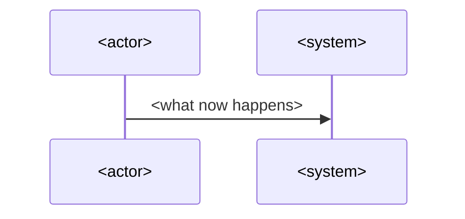

# Pull request recap block

The title follows the commit subject rules. The body is this block, then any
footer the harness requires. On updates, `upsert-pr.sh` swaps only the block.

````markdown
<!-- impact-recap:start -->
## Impact

<2-5 sentences. Who notices after merge, what is different for them, and
what they must do now, if anything. No file names, no edit verbs as openers.>

## Why

<The problem, request, or constraint behind the change.>

## Risk: <low|medium|high>

| Area | Risk | What changes in behavior |
| ---- | ---- | ------------------------ |
| <area from facts.sh> | <level> | <consequence, not edit> |

<What could break, for whom, and what would reveal it. Rollback path if not
a plain revert.>

## Flow



## Changes

- <one bullet per logical change, not per file>

## Verification

- <command or check run, and its result>
- <what was not verified, stated plainly>
<!-- impact-recap:end -->
````

## Section rules

- Required, in this order: `Impact` (first), `Why`, `Risk: <level>`,
  `Verification`. Impact is 2-5 sentences and at least 20 words; `lint.sh`
  enforces the word floor. Risk holds the area table; Verification holds at
  least one `- ` item. Optional: `Flow`, `Changes`, `Before / after`.
- Omit an optional section rather than leaving it empty.
- `Risk` level is at least the floor from `facts.sh`. The table has one row
  per area that `facts.sh` reports, named in plain words a reviewer knows
  ("CI checks", "agent settings"), not the internal area label; merge rows
  only when they share a consequence.
- `Flow` appears only when a control or data path changes. Prefer a sequence
  diagram; use a flowchart when the change is about ordering of gates or
  steps. Label every arrow with what this PR makes happen. No `;` inside the
  diagram.
- `Before / after` is for interface, schema, command, or config shape changes:
  two short fenced blocks or a two-column table.
- `Verification` lists what actually ran. "Not verified: X" is better than
  silence. Never claim a check you did not run.
- `Changes` is where diff-level facts live. Group by intent, not by file.
  It must not restate Impact or the Risk table; omit it when they already
  cover the change.
- Each fact appears once. Aim for under 250 words outside tables and
  diagrams; `lint.sh` fails above 350.
- A diagram earns its place only when it shows an ordering or path that
  prose would need several sentences for.
